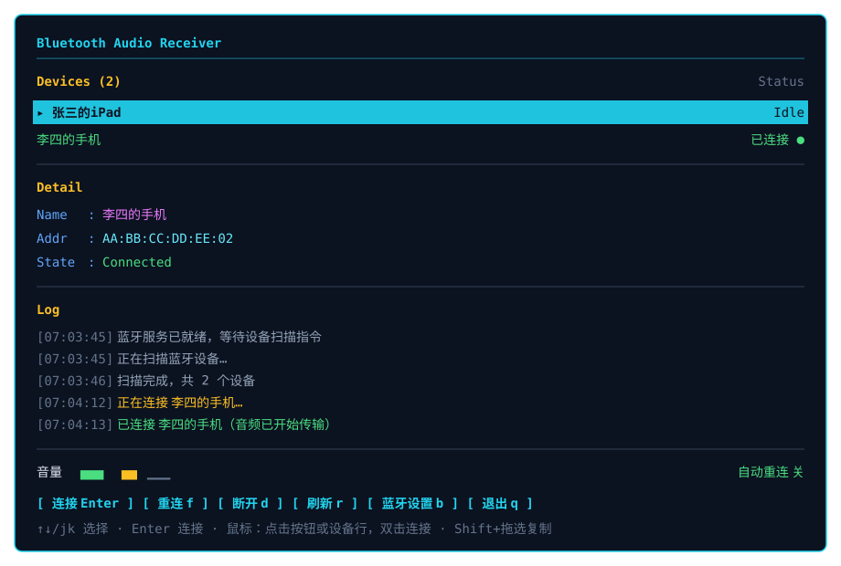

# Bluetooth Audio Receiver (Rust TUI)

把 Windows PC 当成蓝牙音箱用：接收手机 / 平板推送的 A2DP 音频，从 PC 的扬声器或耳机播放。

界面是纯终端 TUI，底层使用 Windows 自带的 `Windows.Media.Audio.AudioPlaybackConnection`（WinRT），
不引入第三方音频库，不引入异步运行时。



---

## ⚠️ 平台限制

**本项目仅支持 Windows。**

| 项 | 要求 |
|---|---|
| 操作系统 | **Windows 10 版本 2004（build 19041）或更高**；Windows 11 可直接使用 |
| 硬件 | 蓝牙适配器可用 |
| 前置条件 | 音频源设备（手机 / 平板）已在「设置 → 蓝牙和其他设备」中**完成配对** |

底层 API `AudioPlaybackConnection` 是 Windows 独有的，Linux / macOS 无法运行，也不存在等价替代。

---

## 它做什么

- 列出已配对、可作为音频源（A2DP Source）的蓝牙设备
- 选中设备后建立连接，设备上的声音改由 PC 播放
- 显示实时音频电平，判断「有没有声音真的传过来」
- 一键强制重连（用于绕过一个 Windows 的已知缺陷，见下文）

## 它不做什么

- **不**转发、不录制、不解码音频。音频数据由 Windows 蓝牙栈直接送到系统默认音频输出设备，本程序只负责发起和维持连接。
- **不**支持同时连接多个设备（系统 API 一次只维护一条连接）。
- **不**是蓝牙音频**发送端**——不能把 PC 的声音推到蓝牙音箱。

---

## 下载即用

从 [Releases](../../releases) 下载 `bluetooth-audio-receiver-win64.zip`，解压后直接双击 exe。

程序为单文件，只依赖 Windows 系统 DLL，无需安装运行时。

---

## 从源码构建

需要 Rust 工具链。仓库通过 `rust-toolchain.toml` 指定了 **GNU (MinGW-w64)** 工具链，
这样没有 Visual Studio Build Tools 的机器也能编译。

```bash
cargo build --release
# 产物：target/release/bluetooth-audio-receiver.exe
```

如果你已安装 MSVC + Windows SDK，可以删除 `rust-toolchain.toml` 改用默认的 msvc 工具链。

---

## 操作

### 键盘

| 按键 | 作用 |
|---|---|
| `↑` `↓` 或 `j` `k` | 选择设备 |
| `Enter` | 连接选中设备 |
| `f` | 强制重连（断开 → 冷却 1 秒 → 重新连接） |
| `d` | 断开当前连接 |
| `r` | 重新扫描设备 |
| `b` | 打开系统蓝牙设置 |
| `q` / `Esc` | 退出 |

### 鼠标

- 点击底部按钮执行对应操作
- 单击设备行选中，**双击**直接连接
- 鼠标悬停时按钮 / 行会高亮

> 开启鼠标捕获后，在终端里拖选复制文字需要按住 **Shift** 再拖。

### 命令行参数

```
--auto-reconnect-on-silence   连接后 8 秒无音频则自动重连一次
--keep-ime                    不尝试禁用输入法
--dump-ui                     渲染一次界面快照后退出
--help                        查看全部参数
```

---

## 工作原理

```
手机 / 平板 (A2DP Source)
   │  蓝牙，SBC/AAC 编码
   ▼
Windows 蓝牙协议栈（解码在这里）
   │
   ▼
系统默认音频输出设备（扬声器 / 耳机）
```

程序本身**不碰音频数据**，只做三件事：

1. 用 `AudioPlaybackConnection.GetDeviceSelector()` 枚举可作为音频源的设备
2. 调用 `TryCreateFromId()` → `Start()` → `Open()` 建立连接
3. 订阅 `StateChanged` 维护界面状态

音频的解码与播放全部由 Windows 完成。因此**进程退出即断连**。

---

## 已知问题：首次连接没有声音

这是 **Windows A2DP Sink 协议栈的已知缺陷**，影响包括微软官方 *Bluetooth Audio Receiver*
在内的所有实现，不是本程序的 bug。

**现象**：设备显示已连接，但 PC 端没有声音；断开重连一次往往就正常了。

**原因**：A2DP 的「信令 Open」与「媒体流 START」是两个阶段。当 PC（Sink）主动发起连接时，
部分 Source 设备（尤其是 iOS）不会把音频路由过来，因此永远等不到 START。

**本程序的对策**：

1. **看音量条** —— 如果显示「已连接」但音量条不动，说明音频没过来
2. **按 `f` 或点「重连」** —— 自动执行断开→冷却→重连，往往能恢复
3. 开启 `--auto-reconnect-on-silence`，让程序在 8 秒无音频后自动试一次

---

## 已知限制

- 一次只能连接一个设备
- 断开后约 1 秒内重连可能返回 `0x8007001F`，程序内置 3/6/12 秒退避重试
- 中文输入法开启时，字母键可能被输入法捕获而无法进入程序。**用鼠标操作可绕过**，
  或按 `Shift` 切换到英文输入法
- 设备名过长时会在详情区截断，完整设备 ID 见日志

---

## 项目结构

```
src/
├── main.rs          程序入口、终端生命周期、命令行参数
├── app.rs           界面状态机
├── ui.rs            渲染与鼠标命中区域
├── event.rs         键盘事件映射
├── console.rs       控制台输入模式与 IME 处理
└── bt/
    ├── worker.rs    WinRT 工作线程：设备枚举与连接管理
    ├── types.rs     命令 / 事件类型
    ├── meter.rs     WASAPI 音频电平采样
    └── id.rs        设备 ID 解析（提取 MAC 地址）
```

线程模型：UI 线程负责渲染与输入，所有 WinRT 对象集中在工作线程，两者用 `mpsc` 通道通信。

---

## 说明

本项目是对 Microsoft Store 应用 *Bluetooth Audio Receiver* 功能的开源复现，
使用微软公开的 WinRT API 实现，不包含任何来自原应用的代码或资源。
